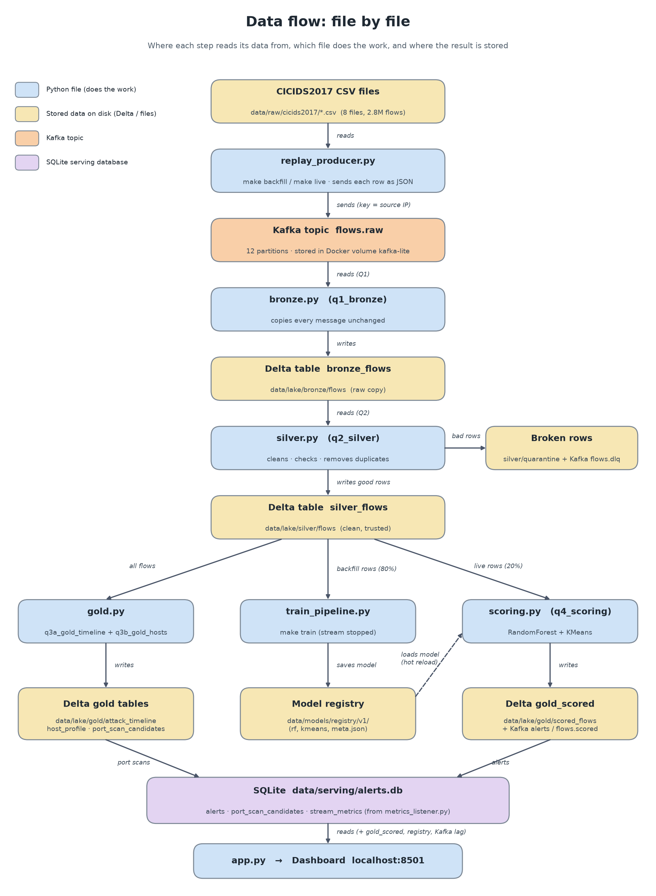

# Data Flow: File by File

One picture of the whole project: **where each step reads its data from**, **which file does the
work**, and **where the result is stored**.

**Colours:** 🟦 blue = a Python file that does the work · 🟨 yellow = stored data on disk ·
🟧 orange = Kafka topic · 🟪 purple = SQLite database for the dashboard.

---

## The steps in one table

| # | File (does the work) | Reads from | Writes to |
|---|---|---|---|
| 1 | `src/ingestion/replay_producer.py` (`make backfill`, `make live`) | CSV files in `data/raw/cicids2017/` | Kafka topic **`flows.raw`** (stored in the Docker volume `kafka-lite`) |
| 2 | `src/streaming/bronze.py` (**q1_bronze**) | Kafka `flows.raw` | Delta **`bronze_flows`** → `data/lake/bronze/flows` |
| 3 | `src/streaming/silver.py` (**q2_silver**) | Delta `bronze_flows` | Delta **`silver_flows`** → `data/lake/silver/flows`; broken rows → `data/lake/silver/quarantine` + Kafka `flows.dlq` |
| 4 | `src/streaming/gold.py` (**q3a**, **q3b**) | Delta `silver_flows` (all rows) | Delta **gold tables** → `data/lake/gold/attack_timeline`, `host_profile`, `port_scan_candidates`; port scans also → SQLite |
| 5 | `src/ml/train_pipeline.py` (`make train`) | Delta `silver_flows`, **backfill rows only** (80%) | **Model registry** → `data/models/registry/v1/` (rf, kmeans, meta.json) |
| 6 | `src/streaming/scoring.py` (**q4_scoring**) | Delta `silver_flows`, **live rows only** (20%) + the model from the registry | Delta **`gold_scored`** → `data/lake/gold/scored_flows`; Kafka `flows.scored` and `alerts`; alerts also → SQLite |
| 7 | `src/streaming/metrics_listener.py` | progress of every streaming query | SQLite `stream_metrics` |
| 8 | `src/dashboard/app.py` (`make dashboard`) | SQLite **`data/serving/alerts.db`**, Delta `gold_scored`, the registry, Kafka (for lag) | the web page at http://localhost:8501 |

Steps 2, 3, 4, 6 and 7 all run inside **one** program started by `make stream`.

---

## Where everything is stored

| What | Where on disk | Format |
|---|---|---|
| Original dataset | `data/raw/cicids2017/` | 8 CSV files |
| Kafka messages | Docker volume `kafka-lite` (inside the Kafka container) | Kafka log |
| Bronze, silver, gold tables | `data/lake/bronze/…`, `data/lake/silver/…`, `data/lake/gold/…` | Delta Lake (Parquet files + `_delta_log/`) |
| Streaming bookmarks | `data/checkpoints/<query name>/` | Spark checkpoints |
| Trained models | `data/models/registry/v1/` | MLlib models + JSON |
| Dashboard data | `data/serving/alerts.db` | SQLite |

In this simple folder, `data/` is a link to `../anomaly-detection-platform/data`, so both folders
use the same stored data.

---

## How to explain the picture (30 seconds)

> "The **producer** reads the CSV files and sends each flow into **Kafka**. **bronze.py** copies
> every message into the bronze Delta table. **silver.py** reads bronze, cleans it, and writes the
> silver table; broken rows go to quarantine. Silver is then read by three things: **gold.py** counts
> flows per minute and per computer, **train_pipeline.py** trains the models on the 80% history and
> saves them in the model registry, and **scoring.py** loads that model and judges the 20% live
> flows, writing alerts. Finally, the **dashboard** reads a small SQLite database plus the scored
> table, so it shows results instantly without running Spark."
